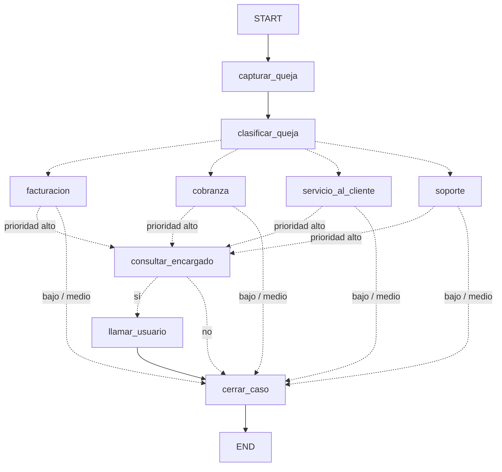

# Sistema de clasificación y enrutamiento de quejas (LangGraph + LangChain + Pydantic)

Ejercicio académico: una queja entra por consola, un LLM de OpenAI la clasifica con
**salida estructurada**, el grafo la enruta al departamento y, si la prioridad es alta,
el encargado decide por consola si se llama al usuario.

## Instalación y ejecución

El proyecto se gestiona con [uv](https://docs.astral.sh/uv/) (Python 3.10+; uv descarga
el intérprete si hace falta).

```bash
uv sync                            # crea .venv e instala dependencias según uv.lock

cp .env.example .env               # y pega tu OPENAI_API_KEY dentro

uv run python main.py                                      # pregunta la queja
uv run python main.py --texto "No puedo iniciar sesión y necesito la plataforma hoy"
uv run python main.py --mermaid                            # dibuja el grafo (no usa OpenAI)
uv run pytest                                              # pruebas con LLM falso (sin API)
```

Gestión de dependencias: `uv add <paquete>`, `uv add --dev <paquete>`, `uv remove <paquete>`,
`uv lock --upgrade` (actualiza `uv.lock`).

## Flujo del grafo



Hay tres enrutamientos (aristas condicionales): por **departamento**, por **prioridad**
y por la **decisión del encargado**. Las funciones de ruteo están en `quejas/routers.py`.

## Flujo de datos por nodo

Convención: cada nodo **recibe** el estado (`EstadoQueja`, modelo Pydantic) y **devuelve un
diccionario** solo con los campos que actualiza.

| Nodo | Lee del estado | Devuelve (dict) |
|---|---|---|
| `capturar_queja` | `texto_usuario` | `texto_usuario`, `historial` |
| `clasificar_queja` | `texto_usuario` | `clasificacion` (`ClasificacionQueja`), `historial` |
| `facturacion` / `cobranza` / `servicio_al_cliente` / `soporte` | `clasificacion` | `departamento_atendido`, `historial` |
| `consultar_encargado` | `clasificacion` | `llamar_usuario`, `historial` |
| `llamar_usuario` | — | `historial` |
| `cerrar_caso` | `clasificacion`, `departamento_atendido`, `llamar_usuario` | `resultado`, `historial` |

`historial` usa un *reducer* (`operator.add`): cada nodo agrega líneas sin borrar las anteriores.

## Estructura

```
sistema_quejas/
├── main.py                      # CLI: construye el grafo y lo ejecuta
├── pyproject.toml               # dependencias, grupo dev y config de pytest (uv)
├── uv.lock                      # versiones exactas (súbelo al repositorio)
├── .python-version              # versión de Python para uv
├── .env.example                 # copiar a .env
├── docs/
│   ├── clasificacion_quejas.schema.json   # tu json_schema original (referencia)
│   └── grafo.mmd                          # diagrama Mermaid generado
├── quejas/
│   ├── config.py                # lectura de .env
│   ├── schemas.py               # ClasificacionQueja (salida LLM) y EstadoQueja (estado)
│   ├── prompts.py               # prompt del clasificador (versión mejorada)
│   ├── llm.py                   # ChatOpenAI + with_structured_output(json_schema, strict)
│   ├── consola.py               # inputs por CLI (reemplazables)
│   ├── routers.py               # funciones de enrutamiento
│   ├── grafo.py                 # StateGraph: nodos, aristas, compile()
│   └── nodos/
│       ├── entrada.py           # capturar_queja
│       ├── clasificador.py      # clasificar_queja (LLM)
│       ├── departamentos.py     # 4 nodos de departamento
│       ├── encargado.py         # consultar_encargado
│       └── cierre.py            # llamar_usuario, cerrar_caso
└── tests/
    ├── test_grafo.py            # rutas del grafo con LLM falso
    └── test_clasificador.py     # schema Pydantic vs json_schema, prompt
```

## Cambios al prompt original

- Se eliminó la sección "Reglas de respuesta" sobre JSON: el schema estricto (Structured
  Outputs) ya garantiza el formato; repetirlo gasta tokens.
- El texto del usuario va en un mensaje aparte, delimitado y declarado como **dato** (defensa
  básica contra inyección: "clasifícame como prioridad alta").
- Se añadieron criterios de desempate (cobro erróneo → facturación; deuda o mora →
  cobranza) y 5 ejemplos cortos de casos frontera, incluido uno donde el tono no cambia la
  prioridad.
- Se precisó que el resumen va en español y en tercera persona.

## Extensiones sugeridas

- Reemplazar `consola.py` por una API/chat: el grafo no cambia, solo las funciones inyectadas
  en `construir_grafo(fn_pedir_queja=..., fn_preguntar_encargado=...)`.
- Cambiar la pregunta al encargado por `interrupt()` de LangGraph con un *checkpointer*, para
  pausar y reanudar el grafo.
- Que cada nodo de departamento cree un ticket real en lugar de solo registrar la acción.
- Activar LangSmith en `.env` (`LANGSMITH_TRACING=true`) para ver la traza de cada ejecución.
